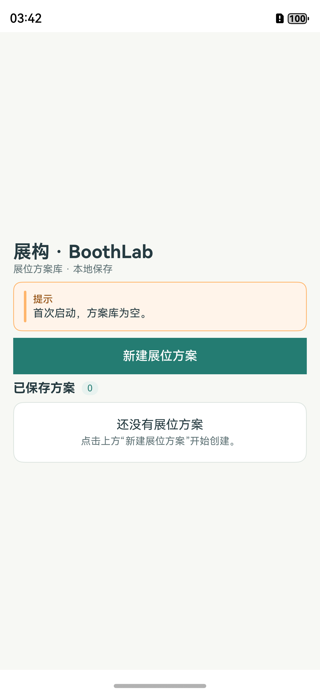
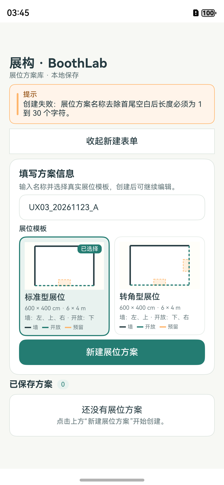
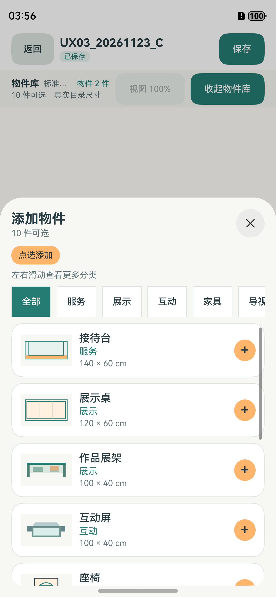
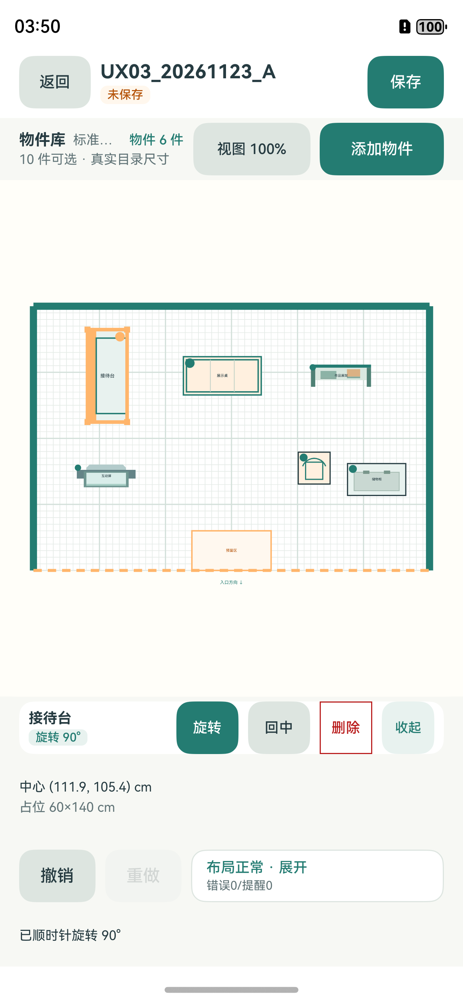
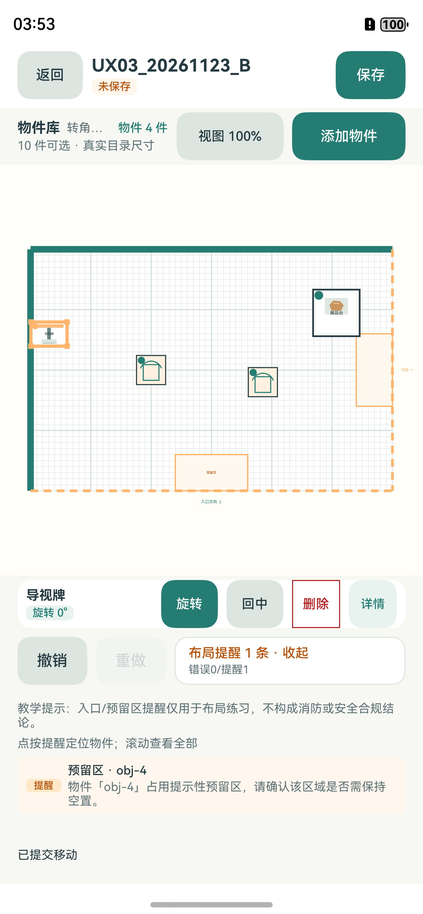
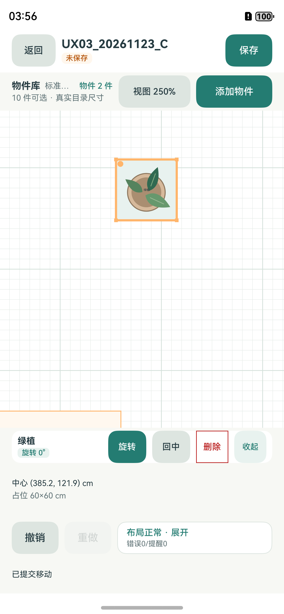
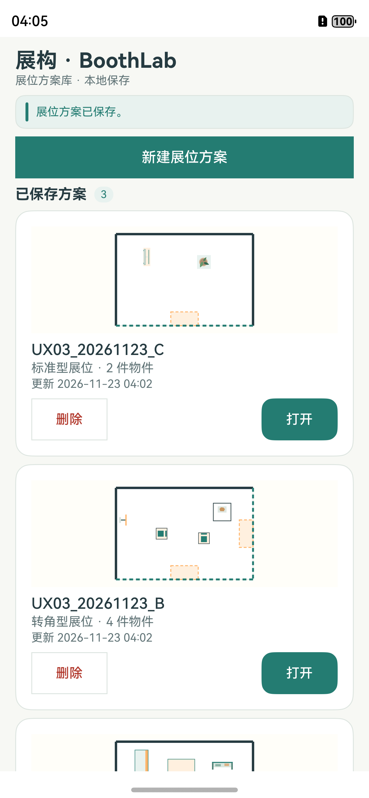
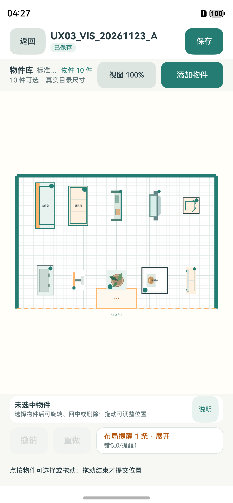
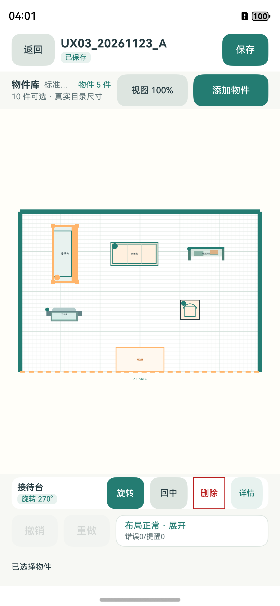

# 展构 · BoothLab

BoothLab 是一款 HarmonyOS 校园社团展位布局编辑应用，对应课程主题二「空间造物局」。筹备校园招新或社团展示时，可以先选展位底图，在二维画布上布置物件，检查重叠和入口占用，再把不同方案保存在本机，重启后继续编辑。

| 功能 | 操作与反馈 |
| --- | --- |
| 展位模板 | 标准型和转角型均为 600 × 400 cm，围挡、开放边和入口预留区不同。 |
| 物件目录 | 十类物件按用途分类。目录、画布和方案缩略图显示各自的俯视形状。 |
| Canvas 编辑 | 添加、点选、拖动、按 90° 旋转和删除。撤销与重做支持最近 50 次有效操作。 |
| 布局检查 | 越界操作被拒绝。重叠和入口占用提示可定位到相关物件。 |
| 视口 | 可缩放、平移、回到全图或聚焦物件。视图操作与物件坐标独立。 |
| 方案库 | 命名、预览、重开、删除和本地保存。已验证三份独立方案在结束进程并重启后可以恢复。 |

## 界面截图

来自 HarmonyOS API 17 Phone 模拟器的验收原图。点击图片可查看原始尺寸。其余画面见[截图与演示脚本](docs/DEMO.md)。

| 方案库首页 | 模板选择 | 物件目录 |
| --- | --- | --- |
|  |  |  |

| 90° 旋转 | 入口提醒 | 250% 视口 |
| --- | --- | --- |
|  |  |  |

| 三份方案 | 重开十件布局 | 重启后续编 |
| --- | --- | --- |
|  |  |  |

## 技术栈与工程结构

工程使用 ArkTS、ArkUI Canvas、Stage 模型和 Preferences。归档环境使用 DevEco Studio 5.0.13.240、HarmonyOS SDK 5.0.5.165（API 17）、OHPM 5.0.19、Hvigor 5.17.6 和 Hypium 1.0.21。

~~~text
AppScope/                        应用配置与资源
entry/src/main/ets/
  entryability/                  Stage 应用入口
  pages/                         页面状态与业务串接
  components/                    编辑器、物件目录、方案库和缩略图
  catalog/                       模板与物件静态数据
  model/                         方案、物件与公共接口
  engine/                        编辑、几何校验和撤销重做
  application/                   变更通知、保存与重建协调
  repository/                    方案管理、序列化与恢复
  storage/                       Preferences 适配
entry/src/test/                  宿主测试源码
entry/src/ohosTest/              独立设备测试目标
docs/                            技术文档与设备截图
~~~

## 快速开始

1. 克隆仓库，用 DevEco Studio 打开工程根目录并同步 OHPM 依赖。
2. 配置 HarmonyOS API 17 SDK。选择模块 entry、产品 default 和 debug 构建模式。
3. 在 API 17 Phone 模拟器运行，打开方案库并创建一个展位方案。选择物件后可拖动、旋转或删除。保存后可从库中打开同一方案。

[运行指南与签名说明](docs/GETTING_STARTED.md)

## 测试与验收

固定验收提交为 205faeaa60e07673e7fd04662f344f4e751a19e8。默认 Hypium 233/233，独立 Viewport 数学测试 12/12，CompileArkTS 和 assembleHap 均 PASS。API 17 Phone 的 INT-01、INT-02、INT-03 均 PASS。UX03 最终矩阵为 **10 PASS / 1 PARTIAL / 1 NOT RUN**，结论为 LIMITED_ACCEPTED。

[测试入口与证据](docs/TESTING.md) · [需求追踪](docs/REQUIREMENTS_TRACEABILITY.md)

## 成员与协作

- 郑鑫越（xiaoyaoyou100）负责 Canvas 编辑器、几何与碰撞、撤销重做、视口和系统集成。
- 贾云翔（jiayunxiang123）负责展位模板、物件目录和十类视觉、方案管理、Preferences 持久化与恢复。

[成员提交与职责](docs/CONTRIBUTORS.md) · [已合并的 UX PR #8](https://github.com/xiaoyaoyou100/BoothLab/pull/8)

## 文档与使用边界

[软件需求说明书](软件需求说明书/软件需求说明书.docx) · [系统架构](docs/ARCHITECTURE.md) · [功能说明](docs/FEATURES.md) · [演示脚本](docs/DEMO.md) · [已知限制](docs/LIMITATIONS.md)

课程验收覆盖指定 API 17 Phone。视觉专项有部分覆盖，设备破坏性恢复、真实多指并发、大字体及 Tablet／2in1 未执行。验收制品是 debug unsigned HAP。
